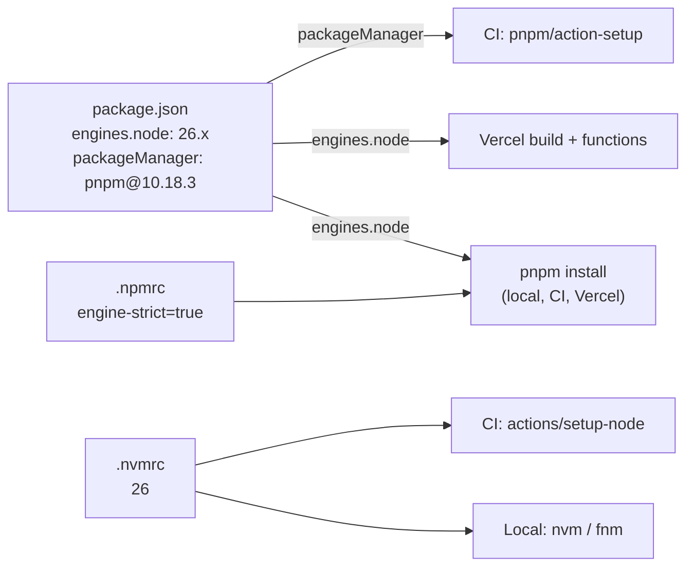

# Pin the Node and pnpm runtime version

*   **Author:** King Rule
*   **Status:** Proposed
*   **Date:** 2026-11-22

--------------------------------------------------------------------------------

## Overview

Right now the repo does not decide which Node version the app runs on. The `>=24`
range in `package.json`, the version hard-coded in the CI workflow, and Vercel's
default each make that choice separately. This change pins Node to the 26.x line
and pnpm to 10.18.3. Local installs, CI and Vercel all read the version from files
in the repo, and installing with the wrong Node version fails instead of printing
a warning.

## The Problem

*   `package.json` declares `engines.node: ">=24"`. Vercel resolves a range to the
    newest major it offers, which is 26.x today. Commit `ab7d74a` meant to run
    production on 24, but production most likely runs 26. A future Node 28 on
    Vercel would be picked up the same way, with no commit in this repo.
*   `.github/workflows/ci.yml:54` hard-codes pnpm `version: 10.18.3`, and line 58
    hard-codes `node-version: 26`. Neither reads from `package.json`, so CI and
    production can drift apart without either file changing.
*   There is no `.npmrc`. If a contributor installs with an unsupported Node
    version, pnpm only warns, and failures show up later as build or runtime
    errors that are harder to trace.
*   `docs/project-context.md:43-47`, `docs/target-state.md:97-104` and
    `README.md:62` say the project declares no runtime floor. That is out of
    date, so readers get the wrong picture.

The fix is to pin Node 26 in two repo files: `engines.node: "26.x"`, which Vercel
and pnpm read, and `.nvmrc: 26`, which CI and local version managers read. CI
takes pnpm from `packageManager`, and `engine-strict` makes a version mismatch
fail the install.

## Goals

*   Local, CI and Vercel all run Node 26.x, and the only source for that is files
    in the repo.
*   CI takes pnpm's version from `packageManager` and Node's from `.nvmrc`, with
    no version numbers in `.github/workflows/ci.yml`.
*   `pnpm install` on a Node major other than 26 exits with an error.
*   Moving to a new Node major takes a deliberate commit that edits both
    `engines.node` and `.nvmrc`.
*   No doc in the repo says the project lacks a runtime floor.

## Non-Goals

*   Running CI on more than one Node version.
*   Adopting Volta or any other version manager besides an `.nvmrc` file.
*   Checking automatically that `engines.node` and `.nvmrc` agree. The author
    accepts keeping the two in sync by hand.
*   Checking how `fetch` behaves under Node 26 on Vercel (the HTTP/1.1 opt-out
    note in Vercel's docs).
*   Changing the pnpm version or the `engines.pnpm` floor (`>=10.0.0`).

## Open Questions

*   **Current production Node version**: no one has confirmed from a Vercel
    deploy log that the live deployment runs 26.x. If it runs 24, this change
    is an upgrade of production and not only a pin.
*   **Vercel dashboard setting**: if the project's Node.js Version setting is
    24.x, `engines.node: "26.x"` overrides it. It is not yet checked whether
    Vercel shows a warning or needs the dashboard updated to match.

## Critical User Journeys (CUJs)

### CUJ 1: Contributor installs on the supported Node

*   **Given**: A clone of the repo and Node 26.x active locally.
*   **When**: The contributor runs `pnpm install`.
*   **Then**: The install succeeds with no engine warning.

### CUJ 2: Contributor installs on an unsupported Node

*   **Given**: A clone of the repo and Node 24.x active locally.
*   **When**: The contributor runs `pnpm install`.
*   **Then**: pnpm exits with a non-zero code and an unsupported-engine error that
    names the required `26.x`.

### CUJ 3: CI runs on the pinned versions

*   **Given**: A pull request against `main`.
*   **When**: The CI workflow runs.
*   **Then**: Node is set up from `.nvmrc` (26.x), pnpm from `packageManager`
    (10.18.3), and the checks pass.

### CUJ 4: Vercel deploys on the pinned Node

*   **Given**: A push to a branch that Vercel deploys.
*   **When**: Vercel builds the project.
*   **Then**: The build log shows Node 26.x and the install does not fail the
    engine check.

## Technical Plan (Architecture)

No application code changes. The change touches only configuration and docs:
two new files at the repo root, one edited field in `package.json`, two edited
steps in the CI workflow, and three doc fixes.

### Where each tool reads its version

*   **Vercel** reads `engines.node`. Per Vercel's docs, `26.x` deploys the
    newest 26.x and takes precedence over the dashboard's Node.js Version setting.
*   **`actions/setup-node`** reads `.nvmrc` through `node-version-file`. The plan
    doesn't point it at `package.json` because `26.x` is a range there, and an
    exact major in `.nvmrc` is clearer. Both resolve to the newest 26.x.
*   **`pnpm/action-setup`** reads `packageManager` when `version:` is left out.
*   **pnpm**, everywhere it runs, compares the active Node to `engines.node`.
    With `engine-strict=true` in `.npmrc`, a mismatch fails the install instead
    of warning.
*   **Local** version managers (nvm, fnm) read `.nvmrc` when the contributor runs
    `nvm use` or has automatic switching on. Nothing forces this; `engine-strict`
    is what blocks a wrong version.

### Keeping the two Node pins in sync

`engines.node` and `.nvmrc` both say 26. Per the Non-Goals this is a manual
contract. Moving to a new major means editing both in the same commit. If only
`.nvmrc` changes, CI runs the new Node but `engine-strict` fails its install
against the old `engines.node`. If only `engines.node` changes, CI's install
fails against the old `.nvmrc`. Either way the mismatch shows up as a red CI run,
not as a silent drift.

### How the open questions get resolved

Running a Vercel preview deploy of this branch settles both open questions. If
the build log shows Node 26.x and the install passes the engine check, the pin
holds. If the build fails, the log names the cause. The fallback is the
"stay on 24" alternative, reached by editing `engines.node` and `.nvmrc` together.

## Alternatives Considered

### Alternative A: Pin to Node 24

Set `engines.node: "24.x"` and `.nvmrc: 24`.

*   **Pros**: Matches the original intent of commit `ab7d74a`. Node 24 has been
    an LTS line for longer, so more packages have been tested on it.
*   **Cons**: It moves local development (v26.8.2), CI (26) and most likely
    production (26) back a major. That is a downgrade of three environments to
    match one old commit message.
*   **Reason for Rejection**: Rejected by author: everything that runs today is
    on 26, so pinning 24 would change behavior instead of recording it. This stays
    as the fallback if the Vercel preview build fails on 26.

### Alternative B: Keep the `>=24` range

Leave `engines.node` as is, and only add `.npmrc` and make CI read from files.

*   **Pros**: The smallest diff. Upgrades happen without anyone editing the repo.
*   **Cons**: Vercel and `actions/setup-node` both resolve a range to the newest
    matching major, so a new Node major would reach production with no commit.
    `engine-strict` can't catch it, because the new major still satisfies `>=24`.
*   **Reason for Rejection**: Rejected by author: the goal is that a Node major
    change takes a commit, and an open range rules that out.

### Alternative C: Run CI on both Node 24 and 26

Use a CI matrix over both majors.

*   **Pros**: Catches code that breaks on either version.
*   **Cons**: Doubles CI time. It tests 24, which nothing runs once 26 is pinned.
*   **Reason for Rejection**: Rejected by author: it costs CI time to test a version
    with no users.

### Alternative D: Pin with `volta.node` in `package.json`

Put the exact version in a `volta` field instead of `.nvmrc`.

*   **Pros**: The Node pin lives in `package.json` next to `engines`.
    `actions/setup-node` reads `volta.node` before `engines.node`.
*   **Cons**: It only helps locally if the contributor uses Volta. nvm and fnm
    ignore it.
*   **Reason for Rejection**: Rejected by author: the author doesn't use Volta,
    and `.nvmrc` works with nvm, fnm and setup-node.

### Alternative E: CI reads `node-version-file: package.json`

Have setup-node read `engines.node` directly, with no `.nvmrc`.

*   **Pros**: One Node pin instead of two, so there is nothing to keep in sync.
*   **Cons**: Local version managers get no file to switch on. The CI Node version
    would depend on how setup-node interprets an npm range instead of on an
    explicit value.
*   **Reason for Rejection**: This was rejected while `engines.node` was still the
    open range `>=24`, which setup-node would resolve to the newest major. With
    `26.x` it would resolve to 26 as well. It stays rejected because the author
    chose an explicit `.nvmrc` that local tools also read, and accepted keeping the
    two pins in sync by hand.

--------------------------------------------------------------------------------

## Non-Functional Requirements

*   **Rollout & Rollback**: The change takes effect on the next deploy. Rollback
    is a revert of the single commit. The first Vercel preview deploy of the
    branch is the rollout check (see Verification Plan).
*   **Contributor impact**: Anyone on a Node major other than 26 gets a failed
    `pnpm install` until they switch. That is the intended behavior.

--------------------------------------------------------------------------------

## Detailed Implementation Plan

### Target Files to Create/Modify

#### 1. `./.nvmrc` (Create)

*   **Type / Scope**: Version-manager config.
*   **Proposed Changes**: One line, `26`, ending in a newline. CI's setup-node and
    local nvm/fnm read it.

#### 2. `./.npmrc` (Create)

*   **Type / Scope**: pnpm config.
*   **Proposed Changes**: One line, `engine-strict=true`. This makes
    `pnpm install` fail when the active Node doesn't satisfy `engines.node`. It
    holds no registry tokens or other secrets. pnpm settings that live in
    `pnpm-workspace.yaml` stay there.

#### 3. `./package.json` (Modify)

*   **Type / Scope**: Package manifest.
*   **Proposed Changes**: `engines.node` changes from `">=24"` to `"26.x"`.
    `engines.pnpm` (`">=10.0.0"`) and `packageManager` (`"pnpm@10.18.3"`) stay as
    they are. `pnpm-lock.yaml` doesn't change, because `engines` isn't part of the
    lockfile.

#### 4. `./.github/workflows/ci.yml` (Modify)

*   **Type / Scope**: CI workflow.
*   **Proposed Changes**:
    *   `pnpm/action-setup@v4`: remove the `with: version: 10.18.3` block so the
        action reads `packageManager`.
    *   `actions/setup-node@v4`: replace `node-version: 26` with
        `node-version-file: .nvmrc`, and keep `cache: pnpm`.
    *   No other step changes.

#### 5. `./docs/project-context.md` (Modify, lines 43-47)

*   **Type / Scope**: Project doc.
*   **Proposed Changes**: Replace the "No runtime floor is declared" paragraph
    with the current facts:
    *   Node is pinned to the 26.x line in two places, `engines.node` and
        `.nvmrc`, and a major bump edits both.
    *   pnpm is pinned via `packageManager: pnpm@10.18.3`.
    *   `.npmrc` `engine-strict=true` makes a mismatched install fail.
    *   CI reads `.nvmrc` and `packageManager`.

#### 6. `./docs/target-state.md` (Modify, lines 97-105)

*   **Type / Scope**: Not-yet-built requirements doc.
*   **Proposed Changes**: Delete the whole "Runtime floor enforcement" section,
    including its trailing `---` separator. The file's own rule is that it lists
    only unbuilt work, so a finished item gets removed instead of marked done.

#### 7. `./README.md` (Modify, lines 62-63 and 130)

*   **Type / Scope**: Repo README.
*   **Proposed Changes**:
    *   Lines 62-63: replace the "No runtime floor is declared" paragraph with one
        sentence saying Node 26.x and pnpm 10.18.3 are pinned and enforced on
        install, with a pointer to `docs/project-context.md`.
    *   Line 130: remove "No declared runtime floor" from the production-readiness
        row. The rest of the row stays: "no rule for which migration verb
        production uses, no deployment target".

#### 8. `./discussion_summary.md` (Delete)

*   **Type / Scope**: Temporary EGM input.
*   **Proposed Changes**: Delete it once the design is finalized. Its content is
    folded into this design.

### Verification Plan

*   **Pin enforcement (CUJ 2)**: Locally, switch to Node 24 and run
    `pnpm install`. It must exit non-zero with an unsupported-engine error. This
    is also the check that pnpm 10 honors `.npmrc` `engine-strict`. If it only
    warns, stop and revisit the design.
*   **Happy path (CUJ 1)**: On Node 26, `pnpm install` succeeds with no engine
    warning.
*   **Build and tests**: `pnpm typecheck && pnpm lint && pnpm test:unit && pnpm build`
    passes locally on Node 26.
*   **CI (CUJ 3)**: The PR's CI run logs show setup-node resolving 26.x from
    `.nvmrc` and pnpm 10.18.3, and every job passes.
*   **Vercel (CUJ 4)**: The branch's preview deploy log shows Node 26.x and a
    successful build. If it fails on 26, take Alternative A by editing
    `engines.node` and `.nvmrc` together.
*   **Docs**: `grep -rn -i 'no runtime floor\|No declared runtime floor' README.md docs/`
    returns nothing.

*Drafted with EGM*
